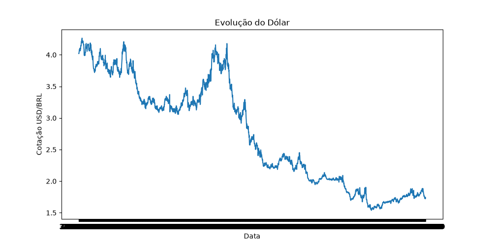
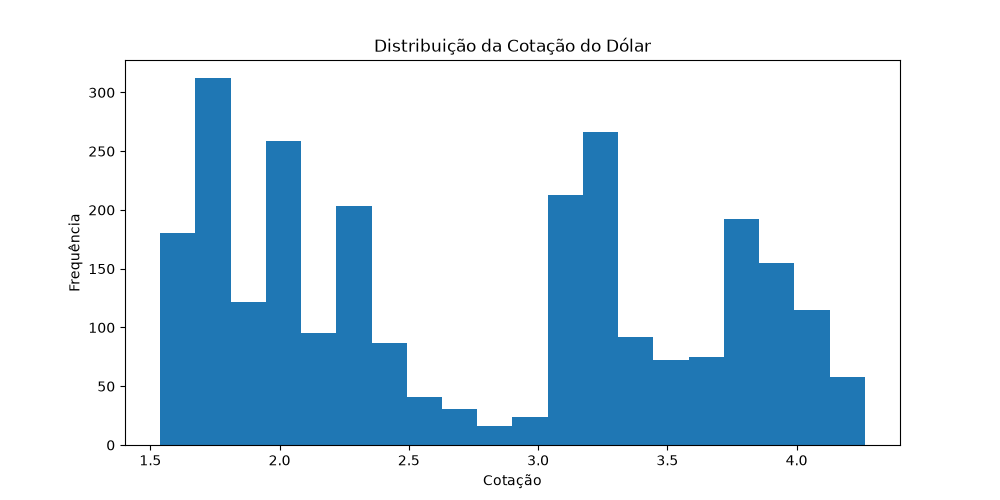

# 📊 Análise de Dados da Cotação do Dólar

Projeto desenvolvido em Python para análise histórica da cotação USD/BRL.

## Tecnologias Utilizadas

- Python
- Pandas
- Matplotlib

## Objetivo

Analisar o comportamento da cotação do dólar ao longo do tempo utilizando técnicas de análise e visualização de dados.

## Gráficos Gerados

### Evolução do Dólar

### Distribuição das Cotações

### Boxplot das Cotações

## Autor

Filipe Rodrigues