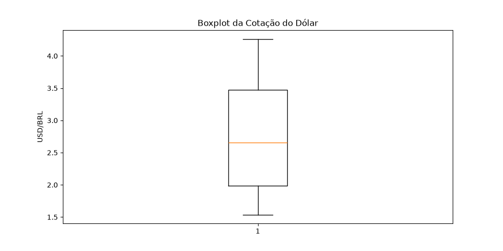

# 📊 Análise de Dados da Cotação do Dólar


## 📌 Sobre o Projeto

Projeto desenvolvido para a disciplina de Visualização da Informação do curso de Ciência da Computação da UDF.

O projeto utiliza Python para analisar o comportamento histórico da cotação do dólar em relação ao real (USD/BRL), aplicando técnicas de análise exploratória e visualização de dados.

## 🎯 Objetivos

- Analisar a evolução histórica da cotação do dólar.
- Identificar tendências de alta e queda.
- Analisar a distribuição e a frequência das cotações.
- Identificar a dispersão dos dados e possíveis valores atípicos.

## 🛠️ Tecnologias Utilizadas

- Python
- Pandas
- Matplotlib
- Visual Studio Code
- GitHub

## 📂 Dataset

O conjunto de dados foi disponibilizado pela instituição de ensino através do Ambiente Virtual de Aprendizagem (AVA).

| Coluna | Descrição |
|---|---|
| Data | Data do registro |
| USD_BRL | Cotação do dólar em reais |

[Acessar o dataset utilizado](USD_BRL_hist.csv)

## 📈 Gráficos Gerados

### 1. Evolução Histórica do Dólar

Gráfico de linhas que representa o comportamento da cotação ao longo do tempo.


### 2. Distribuição das Cotações

Histograma que apresenta a frequência dos valores registrados.


### 3. Boxplot das Cotações

Visualização estatística que permite analisar a mediana, os quartis, a dispersão e possíveis valores atípicos.



## 🚀 Como Executar

Clone ou baixe o repositório e abra o terminal na pasta do projeto.

Instale as dependências:

```bash
python -m pip install -r requirements.txt
```

Execute o projeto:

```bash
python main.py
```

## 🎥 Apresentação do Projeto

Demonstração técnica e conceitual do projeto, incluindo a execução do código e a interpretação dos gráficos.

[](https://youtu.be/LA_gzxQHWv4)

## 🧠 Conhecimentos Aplicados

- Programação em Python
- Manipulação de dados
- Análise exploratória de dados
- Visualização da informação
- Estatística descritiva

## 👨‍💻 Autor

**Filipe Rodrigues**

Ciência da Computação — UDF

[GitHub](https://github.com/VelhoiLip)

---

Projeto desenvolvido para fins acadêmicos e de aprendizado.
